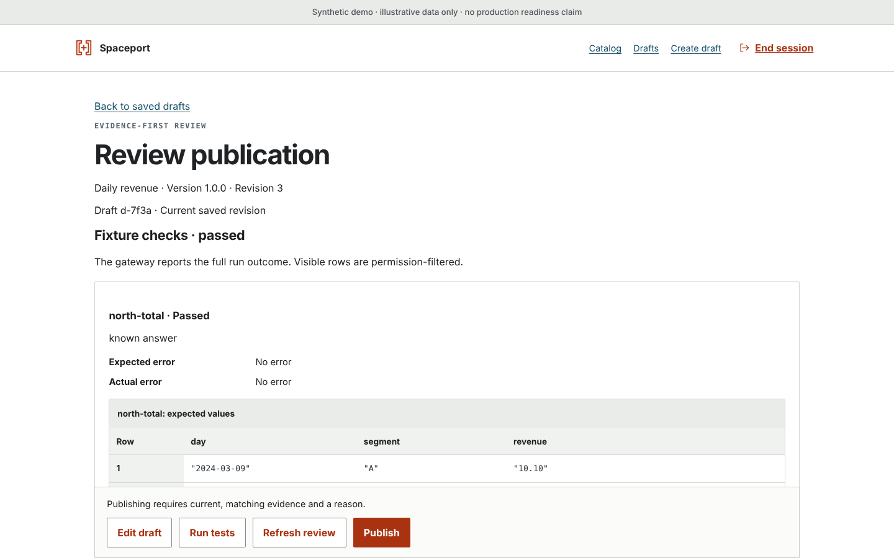

<picture>
  <source media="(prefers-color-scheme: dark)" srcset="docs/assets/brand/banner-dark.svg">
  
</picture>

# Spaceport

> **Frozen since 16 October 2026** ([#10](https://github.com/Sean-Koval/spaceport/issues/10)). Spaceport is the suite's capability plane: governed data products over MCP. It waits while hangar adoption and flightdeck come first.
>
> **Still works:** the local synthetic demo, the REST contract and the four MCP tools, unchanged since [CI run 22](https://github.com/Sean-Koval/spaceport/actions/runs/38800064164) on `2d3cd1e`.
>
> **Allowed:** security fixes, dependency patches, CI repair and docs. Nothing else until the owner records an unfreeze on #10. Agents: read [AGENTS.md](AGENTS.md) first.

**Publish a tested metric once; every agent gets the same permission-checked answer over MCP.**



The publisher's review screen as it stands at the freeze, still in its pre-Airframe styling: the synthetic Daily revenue product, its passing fixture checks, and Publish for a publisher who is not the author.

## Where it fits

In the [agent-factory suite](https://sean-koval.github.io/agent-factory/), hangar runs the agents, Tower governs what they may do, flightdeck judges the results, and Spaceport answers their data questions. Four MCP tools (`search_products`, `describe_product`, `query_product`, `get_result`) return permission-checked rows instead of credentials or SQL. The suite's [architecture page](https://sean-koval.github.io/agent-factory/architecture/) shows the planes; asking Tower's decision point on every call is post-unfreeze work ([#14](https://github.com/Sean-Koval/spaceport/issues/14)).

## What it is for

- **An agent answers a metric without warehouse credentials.** It finds a product with `search_products`, reads its meaning and limits with `describe_product`, and gets rows through `query_product` and `get_result`. Policy is checked on every call.
- **An owner gates publication on known-answer tests.** An author saves a draft and runs its fixture tests; a different person, the publisher, publishes that exact tested revision.
- **Two clients get the same version-pinned answer.** Published versions are immutable, and each result names the product, version and digest it came from. The independent Python and TypeScript client harnesses check this.

## State at freeze

| | Works now | Gated |
| --- | --- | --- |
| Product workflow | Catalog, draft editor, isolated fixture tests, separate publisher, immutable versions, REST and the four MCP tools | Full composed-browser acceptance |
| Sources | Synthetic PostgreSQL/Cube reference; reviewed BigQuery, Domo and GCS paths proven against fixtures only | Any live source: identity, permissions, cost, freshness and network |
| Access | User and client authentication, product policy checks | Owner approval, ReBAC, agent delegation, per-user source entitlements |
| Deployment | Operator CLI, images, GKE review templates | Authorized infrastructure, browser SSO, production rollout |

The full table and the reasons behind each gate are in [release gates](docs/operations/release-gates.md#state-at-freeze). A passing fixture journey does not establish live credentials, PII safety or production readiness.

## Try it with synthetic data

<details>
<summary>Run the local synthetic demo (no vendor account or model-provider key)</summary>

These are the implemented startup commands, not a claim that the full flow has passed acceptance. Read the [operations runbook](docs/operations/runbook.md) first, and use a new disposable state directory, never production credentials or an existing production database.

You need Linux Docker Engine with Docker Compose (`linux/amd64`), Python 3.12 with uv, and Node 24 with npm. The locked installs expect the exact releases in [pinned versions](docs/compatibility/versions.md). Preparation needs network access for packages, images and Playwright Chromium.

```sh
uv sync --locked --dev
npm --prefix publisher ci --ignore-scripts --no-audit --no-fund
npm --prefix clients ci --ignore-scripts --no-audit --no-fund
(cd publisher && npm exec -- playwright install chromium)

umask 077
DEMO_PARENT="$(mktemp -d /tmp/spaceport-demo.XXXXXX)"
STATE_DIR="$DEMO_PARENT/state"
make demo-prepare STATE_DIR="$STATE_DIR"
make demo-up STATE_DIR="$STATE_DIR"
```

Keep the generated state private and out of version control; a source change needs a newly prepared state. Open **http://127.0.0.1:8080**. The synthetic tokens are in `$STATE_DIR/identities/demo-tokens.json`; enter only the intended account's token.

1. As `demo-author`, load the revenue template, save a draft and run its fixtures.
2. As `demo-publisher`, review and publish that exact tested revision.
3. As `demo-north` or `demo-south`, find the product and query the authorized rows.

Nothing is published on first boot, so `/readyz` returns 503 until step 2. Stop with `make demo-down STATE_DIR="$STATE_DIR"`; volumes and state are kept. Backup, restore and acceptance are in the runbook.

</details>

## Read more

- [Documentation index](docs/README.md): every design record, operations, compatibility and evidence document as of the freeze.
- [Architecture at the freeze](docs/architecture.md): what is implemented, how the parts fit, and a repository guide.
- [Verification](docs/operations/verification.md), [release gates](docs/operations/release-gates.md) and the [acceptance index](docs/evidence/acceptance.md).
- [Spaceport in the suite docs](https://sean-koval.github.io/agent-factory/tools/spaceport/) and the [ROADMAP](ROADMAP.md).

Original code is licensed under [Apache-2.0](LICENSE) (see [NOTICE](NOTICE)). "Spaceport" is an internal project name; public distribution under that name needs a separate owner decision.
