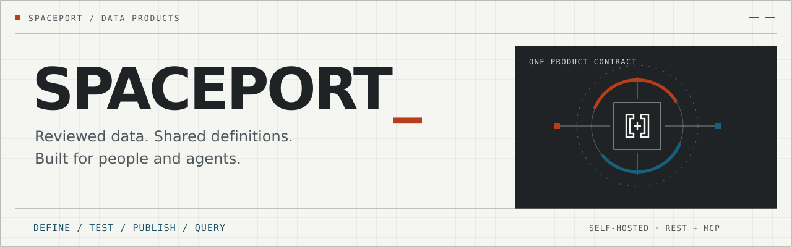

<picture>
  <source media="(max-width: 640px)" srcset="docs/assets/spaceport-banner-mobile.svg">
  
</picture>

# Spaceport

> **Status: frozen (2026-10-16).** Spaceport is the team's capability plane: governed data products over MCP. It is paused while hangar adoption and flightdeck come first.
>
> - **Allowed:** security fixes, dependency patches, and the cleanup issues in the freeze epic ([#10](https://github.com/Sean-Koval/spaceport/issues/10)).
> - **Not allowed:** new connectors, live-source activation, deployment.
> - **Unfreeze:** an owner decision recorded in [ROADMAP](ROADMAP.md#frozen).
>
> The status below is accurate as of the freeze; it describes what exists, not work in progress.

Spaceport is a self-hosted gateway that turns reviewed team data into reusable products that people and agents can discover and query through one governed API. A product defines what an answer means, its typed inputs and outputs, who can use it, how fresh it must be, and the tests required before publication.

The goal is to publish a trusted metric once and reuse the same approved definition across agent clients. The current reference implementation uses synthetic PostgreSQL data through Cube Core, without requiring a model-provider or vendor account. A separate reviewed PostgreSQL/Cube v2 path removes the synthetic Orders-only binding restriction. A reviewed-source pilot adds BigQuery/Cube and finite Domo REST serving, private operator CLI workflows and GKE configuration templates. Its exact-source backend acceptance passed; live activation remains separately gated. GCS remains an offline artifact slice. Domo still requires reconciliation with authoritative cards and Beast Modes.

The private GitHub repository is [Sean-Koval/spaceport](https://github.com/Sean-Koval/spaceport). The uv project is `spaceport` and the publisher package is `spaceport-publisher`; the `gateway/` import package and the `dpg` prefixes in stored identifiers and credential formats are kept for compatibility ([legacy identifiers](docs/compatibility/versions.md#legacy-internal-identifiers)). Original code is licensed under [Apache-2.0](LICENSE) (see [NOTICE](NOTICE)). "Spaceport" is an internal project name; public distribution under that name needs a separate owner decision.

## How it fits

Spaceport is the capability plane in the team's agent tooling. Agents reach governed data products over MCP: they get reviewed, permission-checked answers instead of credentials or SQL. After unfreeze, its MCP tools will also ask the governed workspace's decision point before serving a call ([#14](https://github.com/Sean-Koval/spaceport/issues/14)). Around it, hangar runs the agents, the workspace governs what they may do, and flightdeck judges how well they did. The [documentation index](docs/README.md) lists every design, operations, compatibility, evidence and research document as of the freeze.

## What is implemented

The source includes:

- A permission-filtered catalog, product definitions, examples, units, grain, freshness requirements and provenance.
- A React publisher with an authorized saved-draft inbox, versioned editor, known-answer and permission-negative test results, definition diffs, and publication of the exact tested revision. Author and publisher are separate roles.
- A consumer workspace with permitted typed filters and sorting, in-memory idempotent request recovery, explicit new runs and pinned result identity checks.
- Immutable published versions, audited lifecycle changes, tenant-scoped queries, durable execution, idempotency, bounded results and authorized pagination.
- A REST API and four fixed MCP tools: `search_products`, `describe_product`, `query_product` and `get_result`. Python and TypeScript client harnesses exercise the same contract.
- Synthetic Compose packaging, migrations, generated demo identities, health/readiness checks, backup/restore commands and verification tooling.

Agents receive approved product capabilities, not database credentials or unrestricted SQL. Source models and bindings are operator-reviewed assets; the publisher does not upload executable models.

## Current status

**The BigQuery and Domo connector pilot is merged.** [PR 5](https://github.com/Sean-Koval/spaceport/pull/5) merged at [`27bb504f`](https://github.com/Sean-Koval/spaceport/commit/27bb504f9a673267fd070a4e562b698388ded7e5). [Run 22](https://github.com/Sean-Koval/spaceport/actions/runs/38800064164) passed **3,336 source tests and 406 backend cases**, including the actual runtime images, offline CLI/import smoke and complete synthetic-provider product journeys. Exact cleanup passed. The merge preserves the reviewed documentation-only descendant of that tested source; see the [source-bound receipt](docs/evidence/source-pilot-runtime.md#hosted-attempt-22-exact-source-backend-pass).

**Organization activation remains blocked.** The next security slice is still being implemented and reviewed. A passing fixture journey does not establish live credentials, user-level Domo permissions, PII safety or production readiness.

| Area | Available now | Still gated |
| --- | --- | --- |
| Product workflow | Catalog, draft editor, isolated fixtures, separate publisher, immutable versions, REST + four MCP tools | Full composed-browser acceptance |
| PostgreSQL / Cube | Synthetic reference plus reviewed v2 bindings and same-query checkpoints | Operator-qualified organization models and producer guarantees |
| BigQuery | Reviewed Cube/SDK runtime, bounded jobs, durable source holds, full synthetic-provider journey | Live identity, permissions, cost, freshness and network qualification |
| Domo | Finite reviewed SQL over direct REST, isolated fixture/consumer identities, single-send accounting | Live OAuth/PDP, dataset/business-definition qualification; shared credentials do not inherit employee access |
| GCS | Offline exact-generation artifact reader | Public route, live transport and source-policy inheritance |
| Access security | Current user/client authentication and product policy checks | Revocable owner approval for non-PII products; full ReBAC, agent delegation and per-user source entitlement intersection |
| Deployment | Operator CLI, images, GKE review templates | Authorized infrastructure/credentials, browser SSO/PKCE, production rollout |

See the [acceptance index](docs/evidence/acceptance.md), [limitations](docs/evidence/limitations.md) and [roadmap](ROADMAP.md). Earlier [baseline](docs/evidence/private-main-baseline.md), [runtime foundation](docs/evidence/organization-runtime-foundation.md) and [connector foundation](docs/evidence/reviewed-connectors.md) receipts remain tied to their original revisions.

## Start here

- **Explore with synthetic data:** follow [local setup](#local-synthetic-setup) below. No vendor account or model-provider key is required.
- **Prepare a BigQuery or Domo product:** use the [operator setup and team workflow](docs/operations/source-pilot.md). Package creation and validation are offline; rendering does not provision or deploy resources.
- **Understand the contract:** read the [OpenAPI snapshot](docs/compatibility/openapi.json) and [four-tool MCP profile](docs/compatibility/mcp.md).
- **Plan an organization pilot:** review the [remaining security and live-source gates](#bigquery-and-domo-pilot) before configuring access.

## Architecture

The React UI and MCP clients call the same Python gateway services. The gateway authenticates the caller, checks current policy, pins a product version and builds a query from its approved binding. A worker processes bounded jobs through the reviewed provider adapter; consumers retrieve authorized, typed result envelopes.

- **Gateway:** Python, FastAPI and the MCP SDK; contracts, catalog, authorization, publishing, execution and results.
- **Registry:** PostgreSQL stores definitions, draft revisions, publication evidence, executions, results and redacted audits. Alembic manages schema changes.
- **Semantic execution:** separate Cube services use reviewed PostgreSQL or BigQuery models; Domo executes finite reviewed REST statements. Fixture execution uses independently pinned source identities and assets.
- **Publisher:** React, TypeScript and Vite with generated OpenAPI types, served by the local edge service.
- **Operations:** separate worker and retention processes; only the edge exposes loopback ingress. Cube and database ports remain private.

REST routes use `/v1`; MCP uses JSON Streamable HTTP at `/mcp`. The [saved-draft inbox](docs/compatibility/drafts.md) is a bounded, authorized REST discovery surface; the four MCP tools are unchanged. See the [OpenAPI snapshot](docs/compatibility/openapi.json), [MCP profile](docs/compatibility/mcp.md) and [tool schemas](docs/compatibility/mcp-tools.json). Result freshness refers to the recorded source-load watermark, not the time a query was fetched.

## BigQuery and Domo pilot

**Organization activation is blocked pending the separately reviewed data-access security gate.** This merged connector pilot does not implement per-user Domo entitlement intersection, a user–agent delegation relationship model, or a complete PII field policy. Current product labels and shared source credentials are not proof of those controls. The next bounded slice must enforce revocable data-owner approval for explicitly reviewed non-PII shared-identity products; ultimate per-user access remains a separate provider-qualified mode.

Start with the [operator setup and team workflow](docs/operations/source-pilot.md). The supported CLI builds and validates a fixed weekly-account-usage package offline, renders a zero-replica GKE review bundle, and guides author → isolated fixture test → separate publisher → bounded consumer check. Existing cluster, registry, IdP, source views/datasets, reviewed network access and operator-managed credentials are prerequisites. Rendering does not create them or deploy anything.

BigQuery uses GKE Workload Identity; Domo uses separately restricted OAuth integration identities. Domo MCP is not the approved-statement serving transport. Shared Domo credentials do not inherit each employee’s PDP. No organization query, cloud deployment or browser SSO is established by the fixture evidence.

## Local synthetic setup

These are the implemented startup commands, not a claim that the full flow has passed acceptance. Read the [operations runbook](docs/operations/runbook.md) before running them. Use synthetic data and a new disposable state directory, never production credentials or an existing production database.

Prerequisites:

- Operator-controlled Linux Docker Engine with Docker Compose, `linux/amd64`.
- Exact toolchain: Python **3.12.14**, uv **0.12.23**, Node **24.19.0**, npm **11.9.0**. The Node pin does not supply the required npm version automatically.
- Network access during preparation to acquire locked packages, images and Playwright Chromium; required browser system libraries must already be available before verification.

From the repository root:

```sh
uv sync --locked --dev
npm --prefix publisher ci --ignore-scripts --no-audit --no-fund
npm --prefix clients ci --ignore-scripts --no-audit --no-fund
(cd publisher && npm exec -- playwright install chromium)

umask 077
DEMO_PARENT="$(mktemp -d /tmp/spaceport-demo.XXXXXX)"
STATE_DIR="$DEMO_PARENT/state"
make demo-prepare STATE_DIR="$STATE_DIR"
make demo-up STATE_DIR="$STATE_DIR"
```

The state directory must be absolute, outside the repository and previously nonexistent; its parent must already exist and be private. Preparation generates synthetic credentials, builds locked images and records source/image identities. Keep all generated state private and out of version control. Source changes require a newly prepared state.

Open **http://127.0.0.1:8080**. The synthetic tokens are in `$STATE_DIR/identities/demo-tokens.json`; enter only the intended account's token in the browser. Tokens remain in browser memory.

1. Use `demo-author` to load the revenue template, save a draft and run its fixtures.
2. Use the separate `demo-publisher` account to review and publish that exact tested revision.
3. Use `demo-north` or `demo-south` to discover the product and query the authorized rows.

The first boot intentionally has no published product: `/healthz` can succeed while `/readyz` returns 503. Publication establishes the readiness probe. Demo source data older than its 24-hour freshness limit correctly becomes stale; prepare a fresh stack rather than changing its watermark to hide staleness.

```sh
make demo-down STATE_DIR="$STATE_DIR"
```

Stopping retains volumes and state; `demo-up` resumes them. Startup does not pull images or install dependencies. See the runbook for [backup and fresh-stack restore](docs/operations/runbook.md#backup-and-restore).

## Development and verification

After installing the locked dependencies above, the source-level checks are:

```sh
uv run --locked --offline pytest -m 'unit or contract' -q
npm --prefix publisher test -- --run
npm --prefix publisher run typecheck
npm --prefix publisher run check:generated
npm --prefix publisher run build
npm --prefix publisher run format:check
```

The unrestricted `make test` includes suites requiring real services. The frontend development server (`npm --prefix publisher run dev`) proxies `/v1` to `127.0.0.1:8000`; it does not start a gateway or provision demo state.

For final acceptance, use a clean checkout on the supported Docker host and the two separate wrapper modes:

```sh
umask 077
BACKEND_PARENT="$(mktemp -d /tmp/spaceport-backend.XXXXXX)"
DEMO_TEST_PARENT="$(mktemp -d /tmp/spaceport-acceptance.XXXXXX)"
unset PYTEST_ADDOPTS PYTEST_PLUGINS
bash scripts/verify_gateway_integration.sh --backend "$BACKEND_PARENT/run"
bash scripts/verify_gateway_integration.sh --demo "$DEMO_TEST_PARENT/run"
```

Each `run` path must be new, with a private, owner-controlled parent outside the repository. Keep package/browser caches outside those run directories. Backend mode requires the complete real PostgreSQL/Cube selection. Demo mode requires all 14 integration slots in two independent clean cycles; the second must reuse prepared dependencies and image IDs without acquisition.

The packet observer is not currently available, so full demo acceptance remains blocked even when individual business suites pass. Ordinary `make verify-demo` covers 13 business-verification slots and omits `acceptance_security`; it cannot substitute for final acceptance. Follow the [exact acceptance procedure](docs/operations/runbook.md#separate-final-acceptance-modes), including cleanup and retained source-bound evidence.

## Repository guide

- `gateway/`: contracts, API/MCP, identity/policy, registry, publishing, adapters and execution.
- `publisher/`: UI and component/browser test configuration.
- `cube/`, `fixtures/`, `infra/`: reviewed semantic assets, synthetic data and runtime packaging.
- `clients/`: independent Python and TypeScript MCP acceptance clients.
- `migrations/`, `scripts/`, `tests/`: schema migrations, operational/verifier tools and test suites.
- `docs/`: [documentation index](docs/README.md), [approved design](docs/superpowers/specs/2026-10-13-spaceport.md), [implementation plan](docs/superpowers/plans/2026-10-13-spaceport.md), compatibility, operations and evidence.

## Live sources and release boundaries

Start with the [BigQuery gate](docs/operations/bigquery.md), [Domo Phase 1b gate](docs/operations/domo-phase-1b.md), [identity guide](docs/operations/identity.md) and [production checklist](docs/operations/production-gates.md). A configured connection, a mocked test or a synthetic demo does not establish live-source readiness. The [source pilot design](docs/superpowers/specs/2026-10-15-source-pilot-runtime.md) describes the merged BigQuery/Domo serving paths; GCS remains the earlier offline artifact slice.

V1 excludes ETL, arbitrary SQL/formulas, cross-product joins, source writes, dashboards, ontology engines and agent orchestration. Real credentials, paid queries, deployment and public distribution require their own decisions and verification. Preserve [third-party notices](THIRD_PARTY_NOTICES.md) and the [dependency inventory](docs/operations/licensing.md). Original code is licensed under [Apache-2.0](LICENSE); that license does not cover third-party components and does not authorize publishing images or browser bundles, which remain release gates.
