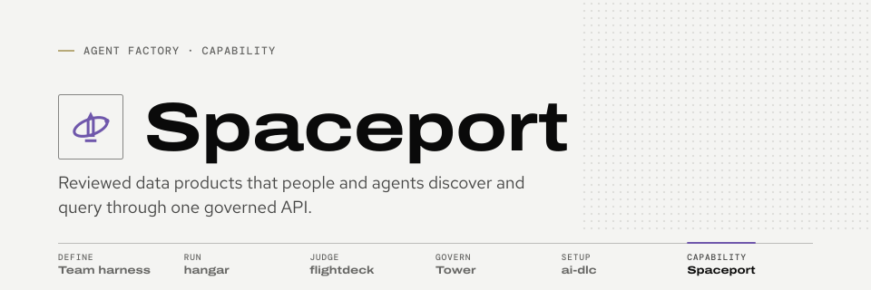

<picture>
  <source media="(prefers-color-scheme: dark)" srcset="docs/assets/brand/banner-dark.svg">
  
</picture>

# Spaceport

> **Status: frozen (2026-10-16).** Spaceport is the team's capability plane: governed data products over MCP. It is paused while hangar adoption and flightdeck come first.
>
> - **Allowed:** security fixes, dependency patches, CI repair, docs fixes and the cleanup issues listed in the freeze epic ([#10](https://github.com/Sean-Koval/spaceport/issues/10)) (#11, #12, #13, #15, all closed). #14 is post-unfreeze work and is not allowed.
> - **Not allowed:** new connectors, live-source activation, deployment.
> - **Still works:** the local synthetic demo and the REST/MCP contract.
> - **Won't change:** the four MCP tools, their schemas and the connectors.
> - **Last CI-verified source:** [run 22](https://github.com/Sean-Koval/spaceport/actions/runs/38800064164) on `2d3cd1e` (15 October). The CI, naming, licensing and docs changes merged since (#16–#20) were not re-run; the gateway, Cube, migration and fixture code is unchanged since that source.
> - **Unfreeze:** an owner decision recorded on [#10](https://github.com/Sean-Koval/spaceport/issues/10) with its date and scope, then noted in the [ROADMAP](ROADMAP.md#frozen).
>
> Everything below describes what existed at the freeze, not work in progress. Agents: read [AGENTS.md](AGENTS.md) first.

**Publish a tested metric once; every agent gets the same permission-checked answer over MCP.**

<!-- #21: add one script-generated, annotated screenshot here: the publisher review screen (author is not the publisher, fixture results) beside a query_product call and its result envelope, with no bearer value in frame. -->
*Screenshot to come ([#21](https://github.com/Sean-Koval/spaceport/issues/21)): the publisher review screen beside an agent's `query_product` call.*

## Where it fits

In the [agent-factory suite](https://sean-koval.github.io/agent-factory/), Spaceport is the capability plane: it exposes reviewed data products as four MCP tools that agents in hangar sandboxes can call, getting permission-checked answers instead of credentials or SQL. hangar runs the agents, Tower governs what they may do, flightdeck judges the results. After unfreeze, each call will also ask Tower's decision point and accept its act-chain tokens ([#14](https://github.com/Sean-Koval/spaceport/issues/14)). The suite's [architecture page](https://sean-koval.github.io/agent-factory/architecture/) shows the planes.

## What it is for

- **An agent answers a metric without warehouse credentials.** It finds a product with `search_products`, reads its meaning and limits with `describe_product`, and gets rows through `query_product` and `get_result`. Policy is checked on every call.
- **An owner gates publication on known-answer tests.** An author saves a draft and runs its fixture tests; a different person, the publisher, publishes that exact tested revision.
- **Two clients get the same version-pinned answer.** Published versions are immutable, and each result names the product, version and digest it came from. The independent Python and TypeScript client harnesses check this.

## Try it with synthetic data

<details>
<summary>Run the local synthetic demo (no vendor account or model-provider key)</summary>

These are the implemented startup commands, not a claim that the full flow has passed acceptance. Read the [operations runbook](docs/operations/runbook.md) first, and use a new disposable state directory, never production credentials or an existing production database.

You need operator-controlled Linux Docker Engine with Docker Compose (`linux/amd64`); exactly Python **3.12.14**, uv **0.12.23**, Node **24.19.0** and npm **11.9.0** (the Node pin does not supply that npm); and network access during preparation for locked packages, images and Playwright Chromium.

```sh
uv sync --locked --dev
npm --prefix publisher ci --ignore-scripts --no-audit --no-fund
npm --prefix clients ci --ignore-scripts --no-audit --no-fund
(cd publisher && npm exec -- playwright install chromium)

umask 077
DEMO_PARENT="$(mktemp -d /tmp/spaceport-demo.XXXXXX)"
STATE_DIR="$DEMO_PARENT/state"
make demo-prepare STATE_DIR="$STATE_DIR"
make demo-up STATE_DIR="$STATE_DIR"
```

Keep the generated state private and out of version control; a source change needs a newly prepared state. Open **http://127.0.0.1:8080**. The synthetic tokens are in `$STATE_DIR/identities/demo-tokens.json`; enter only the intended account's token.

1. As `demo-author`, load the revenue template, save a draft and run its fixtures.
2. As `demo-publisher`, review and publish that exact tested revision.
3. As `demo-north` or `demo-south`, find the product and query the authorized rows.

Nothing is published on first boot, so `/readyz` returns 503 until step 2. Stop with `make demo-down STATE_DIR="$STATE_DIR"`; volumes and state are kept. Backup, restore and acceptance are in the runbook.

</details>

## State at freeze

| Area | Available now | Still gated |
| --- | --- | --- |
| Product workflow | Catalog, draft editor, isolated fixtures, separate publisher, immutable versions, REST + four MCP tools | Full composed-browser acceptance |
| PostgreSQL / Cube | Synthetic reference plus reviewed v2 bindings and same-query checkpoints | Operator-qualified organization models and producer guarantees |
| BigQuery | Reviewed Cube/SDK runtime, bounded jobs, durable source holds, full synthetic-provider journey | Live identity, permissions, cost, freshness and network qualification |
| Domo | Finite reviewed SQL over direct REST, isolated fixture/consumer identities, single-send accounting | Live OAuth/PDP, dataset/business-definition qualification; shared credentials do not inherit employee access |
| GCS | Offline exact-generation artifact reader | Public route, live transport and source-policy inheritance |
| Access security | Current user/client authentication and product policy checks | Revocable owner approval for non-PII products; full ReBAC, agent delegation and per-user source entitlement intersection |
| Deployment | Operator CLI, images, GKE review templates | Authorized infrastructure/credentials, browser SSO/PKCE, production rollout |

Organization activation stays blocked. Owner approvals exist only in paused draft [PR #8](https://github.com/Sean-Koval/spaceport/pull/8), and a passing fixture journey does not establish live credentials, user-level Domo permissions, PII safety or production readiness.

## Read more

- [Documentation index](docs/README.md): every design record, operations, compatibility and evidence document as of the freeze.
- [Architecture at the freeze](docs/architecture.md): what is implemented, how the parts fit, and a repository guide.
- [Verification](docs/operations/verification.md), the [BigQuery and Domo pilot and release boundaries](docs/operations/release-gates.md), and the [acceptance index](docs/evidence/acceptance.md).
- [Spaceport in the suite docs](https://sean-koval.github.io/agent-factory/tools/spaceport/) and the [ROADMAP](ROADMAP.md).

Original code is licensed under [Apache-2.0](LICENSE) (see [NOTICE](NOTICE)). "Spaceport" is an internal project name; public distribution under that name needs a separate owner decision.
